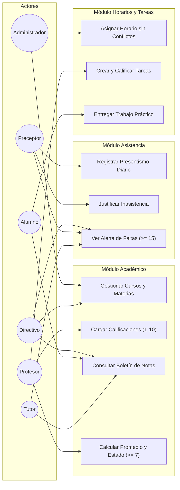

# 07. Casos de Uso del Sistema

## Diagrama de Casos de Uso (Mermaid)

## Descripción de Casos de Uso Clave

### CU-02: Cargar Calificaciones
- **Actor Principal:** Profesor.
- **Precondición:** El docente debe tener la materia y curso asignados en el ciclo lectivo activo.
- **Flujo Principal:**
  1. El profesor selecciona Curso, Materia y Período (1°, 2° o 3° Trimestre).
  2. Crea o selecciona una Evaluación (Parcial, TP, Oral).
  3. Ingresa la calificación de cada alumno en escala de 1.0 a 10.0.
  4. El sistema valida que el valor sea numérico entre 1 y 10.
  5. El sistema calcula si la nota es &ge; 7.0 (Aprobado) o &lt; 7.0 (Desaprobado).
  6. El profesor confirma el guardado y se registra en la auditoría del sistema.

### CU-08: Asignar Horario con Detección de Conflictos
- **Actor Principal:** Administrador / Directivo.
- **Flujo Principal:**
  1. Selecciona curso, materia, docente, aula, día de la semana y rango de horas.
  2. El sistema comprueba si el docente ya tiene otra clase en ese horario.
  3. El sistema comprueba si el aula física ya está ocupada en ese horario.
  4. Si existe solapamiento, rechaza la operación con código HTTP 409 y mensaje explícito.
  5. Si no hay conflicto, persiste el horario en la base de datos.
