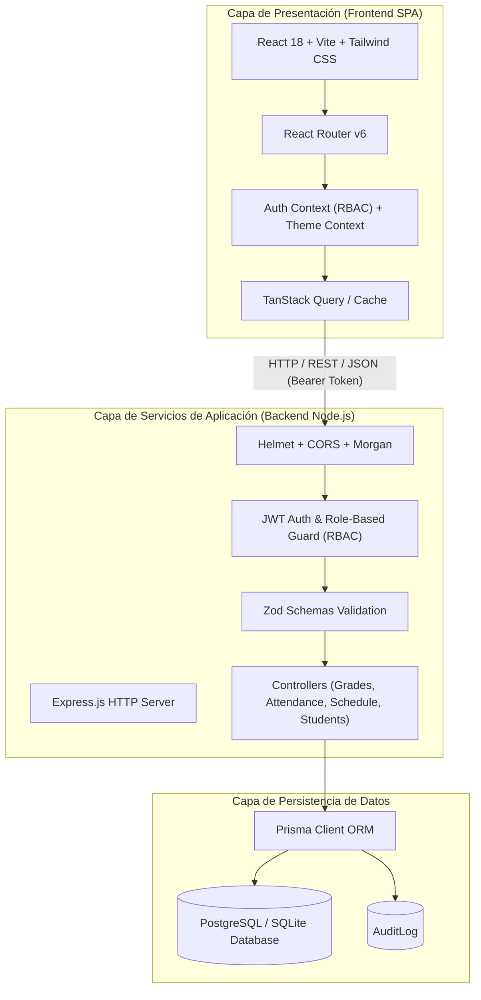

# 09. Arquitectura del Sistema

EduControl adopta un patrón arquitectónico desacoplado en tres capas (Three-Tier Architecture), asegurando alta cohesión, bajo acoplamiento y facilidad de escalado horizontal.

## Diagrama de Arquitectura de Capas (Mermaid)

## Flujo de Seguridad y Autorización
1. El usuario envía credenciales a `/api/auth/login`.
2. El servidor compara el hash con `bcrypt.compare`.
3. Se firma un token JWT conteniendo `userId`, `role`, `schoolId`, y `email`.
4. En cada petición posterior, el middleware `authenticate` verifica la firma criptográfica y `authorize(...roles)` restringe el acceso al endpoint.

